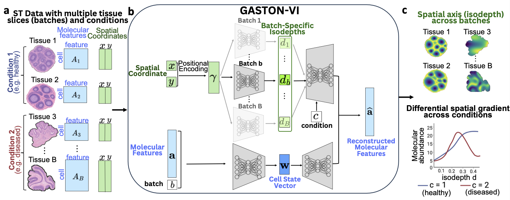

# GASTON-VI

GASTON-VI is a variational inference (VI)-based deep learning model that
efficiently learns an underlying spatial axis, and molecular gradients along this
axis, from multi-sample, multi-condition spatial-omics data of any molecular
modality.

GASTON-VI jointly learns:

* a spatial coordinate, the *isodepth* `d`, for each cell that captures the spatial axis across batches
* 1-D *spatial modality functions*, which describe molecular gradients along
  the isodepth
* a cell state vector for each cell, which captures additional cell-intrinsic
  variation such as cell types



## Installation

```bash
git clone https://github.com/chitra-lab/GASTON-VI.git
cd GASTON-VI
pip install torch pyro-ppl scvi-tools numpy scipy pandas matplotlib scikit-learn
```

A GPU is recommended, but training also runs on CPU.

## Software dependencies

* Python (3.10.19)
* torch (2.10.0)
* pyro-ppl (1.9.1)
* scvi-tools (1.3.3)
* numpy (2.2.6)
* scipy (1.15.3)
* pandas (2.3.3)
* matplotlib (3.10.8)
* scikit-learn (1.7.2)

## Prepare your data

`train.py` reads NumPy `.npy` files, with rows in the same cell or spot order:

| file | flag | shape | contents |
|---|---|---|---|
| coordinates | `--coords_file` | `(N, 2)` | spatial x, y positions |
| expression | `--counts_file` | `(N, G)` | dense matrix: raw counts, or scaled intensities for protein data |
| feature names | `--gene_names_file` | `(G,)` | optional gene or protein names |
| batch labels | `--batch_file` | `(N,)` | joint training only: section index, `0` to `B-1` |

To export from an `AnnData` object:

```python
import anndata as ad, numpy as np

adata = ad.read_h5ad("data.h5ad")
X = adata.layers["counts"]  # or adata.X, if it holds raw counts
np.save("coords.npy", adata.obsm["spatial"])
np.save("counts.npy", X.toarray() if hasattr(X, "toarray") else X)
np.save("gene_names.npy", adata.var_names.to_numpy(dtype=str))
```

## Train

**One section:**

```bash
python train.py \
  --coords_file coords.npy --counts_file counts.npy --gene_names_file gene_names.npy \
  --z_dim 4 --batch_size 2048 --results_dir out/
```

**Several sections:** add `--batch_file batch.npy`. To put the sections on a
shared isodepth scale, also set `--batch_align_weight`.

**Protein data (e.g. CODEX):** scale the intensities first, once per anatomical
region, then add `--likelihood gaussian` to the training command:

```python
import numpy as np
from gaston_vi.preprocess.codex import preprocess_codex

scaled, _ = preprocess_codex(raw_intensities)  # (N, n_proteins)
np.save("counts.npy", scaled)
```

On a Slurm cluster, fill in the partition, paths, and conda environment in
`train.slurm`, then run this from the repository root:

```bash
mkdir -p logs
sbatch train.slurm
```

### Main options

| flag | meaning |
|---|---|
| `--z_dim` | size of the cell state vector |
| `--beta` | KL weight (default `0.01`) |
| `--batch_size` | minibatch size (required) |
| `--pe_auto` | how to set the positional-encoding bands. The default, `single`, derives them from the data for one section, and uses fixed bands (`sigma=0.18`, `num_freqs=16`) for several sections. To set them by hand, pass `--sigma` and `--num_freqs` instead |
| `--epochs`, `--warmup_epochs` | total and warm-up epochs (defaults `175` and `100`). The cell state vector only trains after warm-up, so keep `--warmup_epochs` below `--epochs` |
| `--repeats` | number of random seeds |
| `--di_weight` | weight of the penalty that keeps the cell state vector separate from the isodepth (default `0.01`; `0` turns it off) |
| `--condition_file` | optional `(N,)` integer labels, such as healthy or diseased, to learn a separate `f(d)` per condition. Each batch must lie within one condition |

Run `python train.py --help` for all options.

## Results

Each run writes these under `--results_dir`, with one `rep{i}` per seed:

| path | contents |
|---|---|
| `dec_linear_hz/latents/<run>/rep1/d_mu.npy` | isodepth for each cell |
| `dec_linear_hz/latents/<run>/rep1/z_mu.npy` | cell state vector for each cell |
| `dec_linear_hz/latent_plots/<run>/rep1/` | isodepth and cell state vector plots |
| `dec_linear_hz/loss_plots/` | training curves |
| `dec_linear_hz/models/*.pt` | model checkpoints |
| `summary_*.csv` | final losses and run settings |

To get each gene's `f(d)` curve, run this from the repository root:

```python
import glob
import numpy as np, torch
from gaston_vi.model.gaston_vi import GASTON_VI

ckpt = torch.load(glob.glob("out/dec_linear_hz/models/*rep1.pt")[0],
                  map_location="cpu", weights_only=False)
model = GASTON_VI(**ckpt["model_kwargs"])
model.load_state_dict(ckpt["state_dict"])
model.eval()

d = np.load(glob.glob("out/dec_linear_hz/latents/*/rep1/d_mu.npy")[0])
grid = torch.linspace(d.min(), d.max(), 200).reshape(-1, 1)
with torch.no_grad():
    curves = model.decoder.f_proportions(grid).numpy()  # (200, G)
genes = ckpt["gene_names"]
```

`curves` holds proportions that sum to 1 across genes for count data, and raw
values for `--likelihood gaussian`. If you trained with `--condition_file`, pass
`condition=<label>` to `f_proportions`.

## Support

For questions or bugs, please open a GitHub issue.
